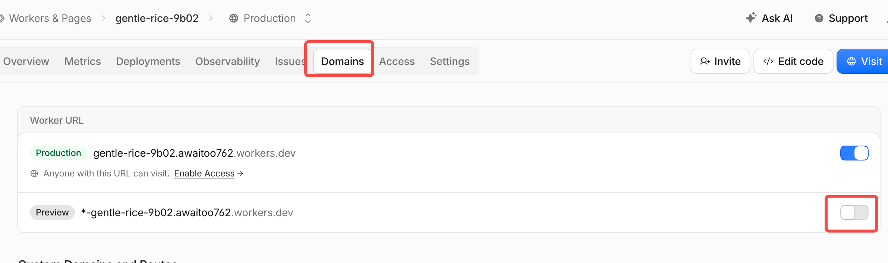
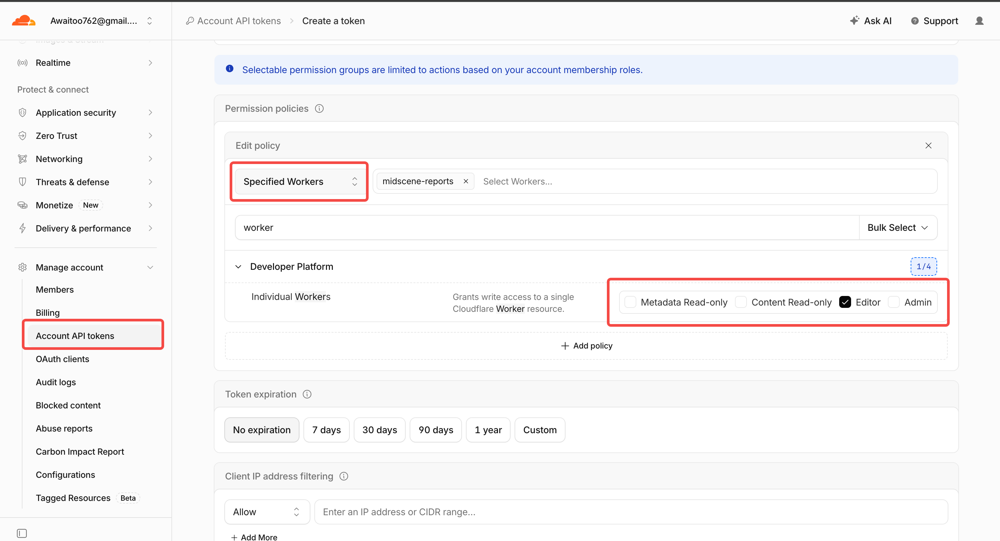
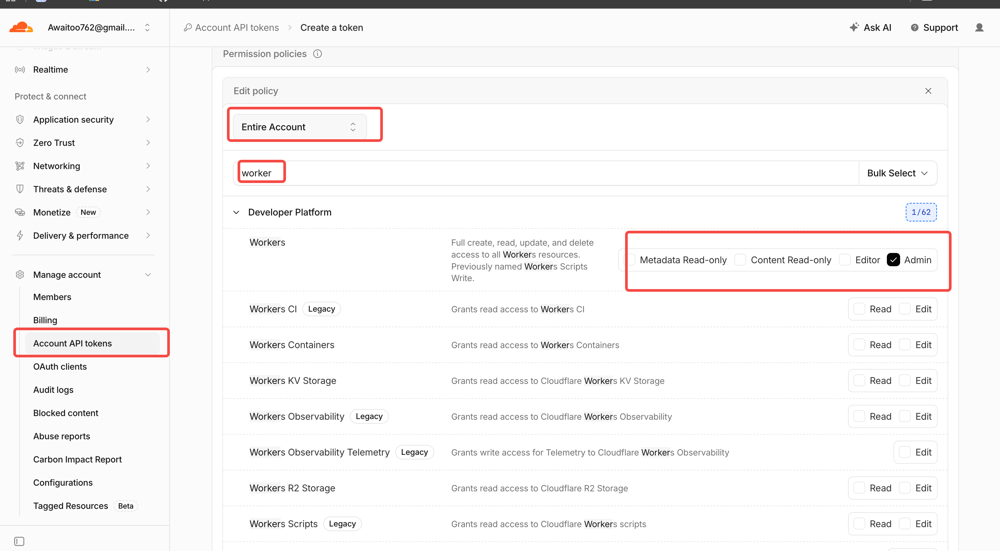
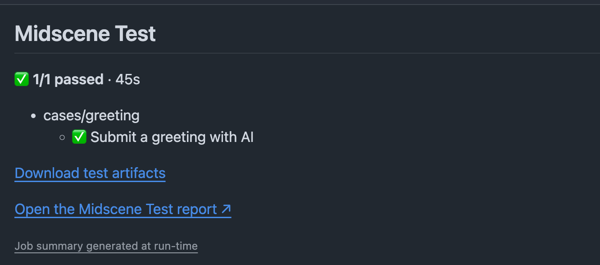

# Midscene GitHub Action

<p align="center">
  <a href="https://github.com/web-infra-dev/midscene-action/actions/workflows/ci.yml"></a>
  <a href="https://github.com/web-infra-dev/midscene-action/tags"></a>
  <a href="LICENSE.md"></a>
</p>

<p align="center">English | <a href="README.zh-CN.md">简体中文</a></p>

Run [Midscene Test](https://midscenejs.com/midscene-test/overview.html) tests in GitHub Actions, with reports you can download or share.

## Features

- Test results in the workflow summary.
- HTML reports and test data uploaded as artifacts.
- Optional report hosting on Cloudflare Workers, with a URL for each run.

## Examples

- [Basic](.github/workflows/example-basic.yml): submit a greeting form with AI and check the result.
- [TodoMVC](.github/workflows/example-todomvc.yml): manage todos with AI and verify the results with custom Nodes.

## Usage

Add the Action to your workflow:

```yaml
- uses: web-infra-dev/midscene-action@v1
  with:
    working-directory: tests/midscene
```

By default, the Action runs `npx midscene-test`. Set `command` to use a different test command, such as `npm test`.

Install your test dependencies and browsers, configure your model, and start any application under test before running the Action.

### Example workflow

For a Playwright project in `tests/midscene`:

```yaml
name: Midscene E2E Tests

on:
  push:
  workflow_dispatch:

permissions:
  contents: read

jobs:
  test:
    runs-on: ubuntu-24.04
    timeout-minutes: 20
    env:
      MIDSCENE_MODEL_API_KEY: ${{ secrets.MIDSCENE_MODEL_API_KEY }}
      MIDSCENE_MODEL_NAME: ${{ vars.MIDSCENE_MODEL_NAME }}
      MIDSCENE_MODEL_FAMILY: ${{ vars.MIDSCENE_MODEL_FAMILY }}
      MIDSCENE_MODEL_BASE_URL: ${{ vars.MIDSCENE_MODEL_BASE_URL }}
    steps:
      - uses: actions/checkout@v6
      - uses: actions/setup-node@v6
        with:
          node-version: '24'
      - name: Install dependencies and browser
        working-directory: tests/midscene
        run: |
          npm ci
          npx playwright install --with-deps chromium
      - name: Run Midscene tests
        id: midscene
        uses: web-infra-dev/midscene-action@v1
        with:
          working-directory: tests/midscene
          command: npm test
```

Set the model secret and variables used above in your repository's **Settings → Secrets and variables → Actions**.

## Inputs

See [action.yml](action.yml) for the full definitions.

| Input                    | Required        | Default             | Description                                                                                            |
| ------------------------ | --------------- | ------------------- | ------------------------------------------------------------------------------------------------------ |
| `working-directory`      | Yes             | None                | Test project directory, relative to the workspace. Use `.` for the repository root.                    |
| `command`                | No              | `npx midscene-test` | Command to run Midscene tests in Bash. Override it with a project script such as `npm test` if needed. |
| `artifact-name`          | No              | `midscene-results`  | Artifact name. Must be unique within a workflow run.                                                   |
| `retention-days`         | No              | `14`                | Artifact retention period in days.                                                                     |
| `publish-pages`          | No              | `false`             | Set to `true` to publish reports to Cloudflare Workers.                                                |
| `cloudflare-api-token`   | When publishing | None                | Cloudflare API token, passed from a GitHub Actions secret.                                             |
| `cloudflare-account-id`  | When publishing | None                | Cloudflare account ID.                                                                                 |
| `cloudflare-worker-name` | No              | `midscene-reports`  | Worker name. Created automatically if needed and the token has permission.                             |

## Publish reports to Cloudflare Workers

Set `publish-pages: true` to publish reports to Cloudflare Workers. Each run gets its own Preview URL in the workflow summary.

- **Free hosting**: no charge for static asset storage or requests. [Billing details](https://developers.cloudflare.com/workers/static-assets/billing-and-limitations/)
- **Retention**: up to 100 Previews per Worker on the free plan. Cloudflare removes the least recently deployed Preview when the limit is reached. [Preview limits](https://developers.cloudflare.com/workers/previews/#limits)
- **Limits**: up to 20,000 files per Worker version and 25 MiB per file on the free plan. [Platform limits](https://developers.cloudflare.com/workers/platform/limits/#static-assets)

### Create an API token

Choose the token permissions for your Worker setup:

| Worker setup                                | Preparation                                                                                                                                                                                                                                                                                                                   | API token permissions                                                                                                                                                                                                                    |
| ------------------------------------------- | ----------------------------------------------------------------------------------------------------------------------------------------------------------------------------------------------------------------------------------------------------------------------------------------------------------------------------- | ---------------------------------------------------------------------------------------------------------------------------------------------------------------------------------------------------------------------------------------- |
| **⭐ Use an existing Worker (recommended)** | <ul><li>Create a Worker in <strong>Workers &amp; Pages</strong> and set <code>cloudflare-worker-name</code> to its name.</li><li>Enable <strong>Preview</strong> under <strong>Domains → Worker URL</strong>.</li></ul>[](assets/cloudflare-worker-preview.png) | Choose **Specified Workers**, select your Worker, and grant **Individual Workers → Editor**.<br><br>[](assets/cloudflare-worker-editor.png)              |
| Let the Action create a Worker              | Set `cloudflare-worker-name` to the name you want to use.                                                                                                                                                                                                                                                                     | Choose **Entire Account** and grant **Workers → Admin**. This allows access to all Workers in the account.<br><br>[](assets/cloudflare-workers-admin.png) |

Save the API token and Account ID from the confirmation dialog. The token is shown only once.

### Enable publishing

In **Settings → Secrets and variables → Actions**, add:

- `CLOUDFLARE_API_TOKEN` as a repository secret.
- `CLOUDFLARE_ACCOUNT_ID` as a repository variable.

Then enable publishing:

```yaml
- name: Run tests and publish reports
  id: midscene
  uses: web-infra-dev/midscene-action@v1
  with:
    working-directory: tests/midscene
    command: npm test
    publish-pages: true
    cloudflare-api-token: ${{ secrets.CLOUDFLARE_API_TOKEN }}
    cloudflare-account-id: ${{ vars.CLOUDFLARE_ACCOUNT_ID }}
```

To use an existing Worker, set `cloudflare-worker-name` to its name. The default is `midscene-reports`.

## Reports

Open the workflow run's **Summary** for test results and artifact downloads. Published reports also have an online preview link.



## Outputs

Set `id: midscene` on the Action step to read its outputs with `${{ steps.midscene.outputs.<name> }}`:

| Output                 | Description                                                          |
| ---------------------- | -------------------------------------------------------------------- |
| `test-result`          | Outcome of the test command.                                         |
| `report-artifact-name` | Name of the uploaded artifact, or empty if no files were uploaded.   |
| `artifact-url`         | Download page for the uploaded artifact.                             |
| `page-url`             | Published report URL, or empty if publishing did not succeed.        |
| `publication-result`   | Deployment outcome: `success`, `failure`, `skipped`, or `cancelled`. |

## Contributing

See the [Contributing Guide](CONTRIBUTING.md).

## License

[MIT](LICENSE.md).

Built with [Midscene](https://github.com/web-infra-dev/midscene) and [Cloudflare Workers](https://workers.cloudflare.com/).

## GitHub Pages

For a dedicated GitHub Pages report site, use the optional `pages` sub-action in
an isolated publishing job. The root Action and its Cloudflare behavior are
unchanged. The caller controls trusted triggers and serializes publication:

```yaml
publish:
  needs: test
  if: >-
    always() && !cancelled() && github.ref == 'refs/heads/main' &&
    needs.test.outputs.report-artifact-name != ''
  runs-on: ubuntu-24.04
  permissions:
    contents: read
    actions: read
    pages: write
    id-token: write
  concurrency:
    group: midscene-pages
    cancel-in-progress: false
  environment:
    name: github-pages
    url: ${{ steps.report.outputs.page-url }}
  steps:
    - uses: actions/setup-node@v6
      with:
        node-version: '24'
    - id: report
      uses: web-infra-dev/midscene-action/pages@v1
      with:
        artifact-name: ${{ needs.test.outputs.report-artifact-name }}
        producer-result: ${{ needs.test.result }}
```

Expose the root Action's `report-artifact-name` as the test job output. Enable
Settings → Pages → Source → GitHub Actions before running this job. Use a
**dedicated** report site; deployment replaces the repository's Pages site.
Pin both Actions to a reviewed commit that includes `pages` (the current release
may predate it). A missing Pages configuration fails the publication job visibly.

The sub-action publishes the framework-generated index and a per-case Summary
with screenshots, status, duration and native step links. It keeps the latest
three runs within 900 MiB; older links expire. Raw test artifacts stay unchanged.
Missing native HTML leaves the existing site intact. Publication can still run
after failed tests. One invocation consumes one native test-run artifact.

History is accepted only from completed non-PR runs in the same repository,
workflow and branch, with commit ancestry verified against the current SHA.
Do not grant this publishing job to untrusted branches or PRs. No caller-side
report scripts, checkout or extra package installation are needed.
